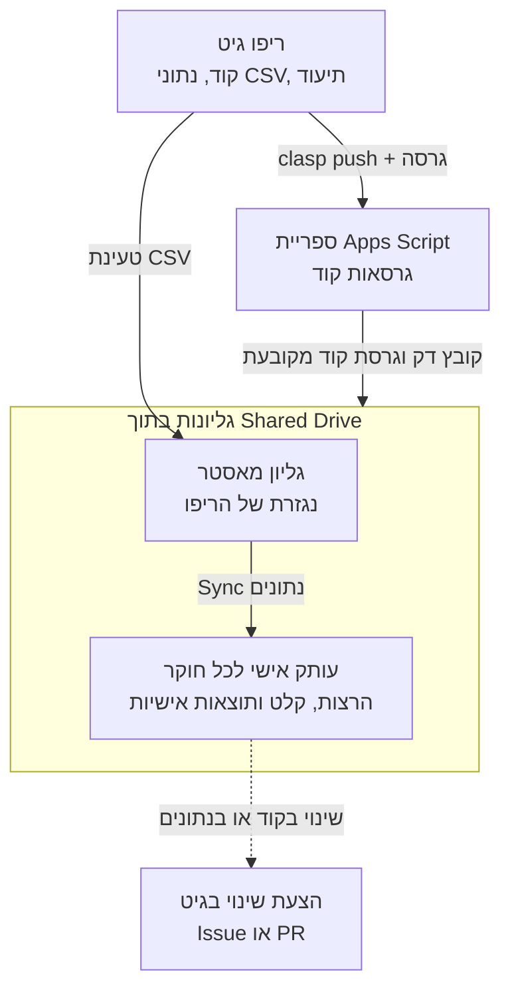
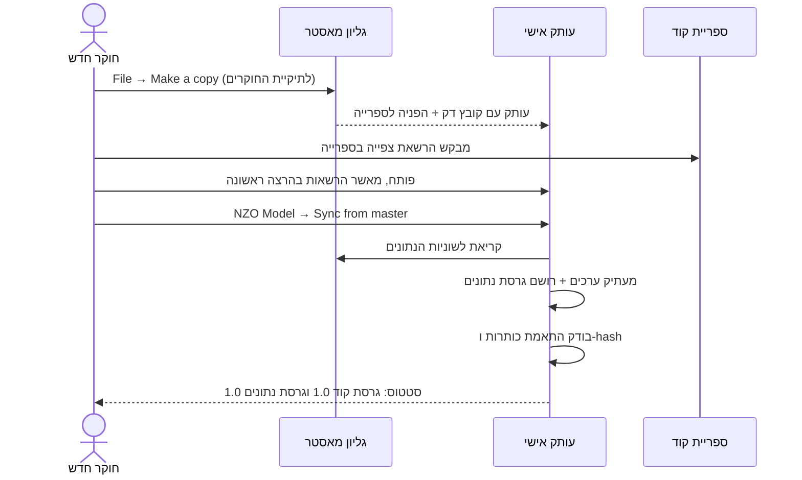
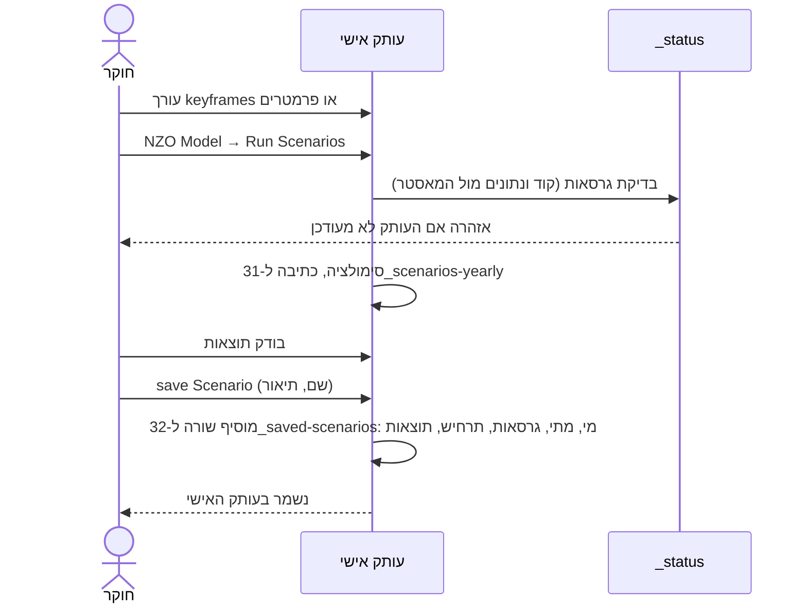
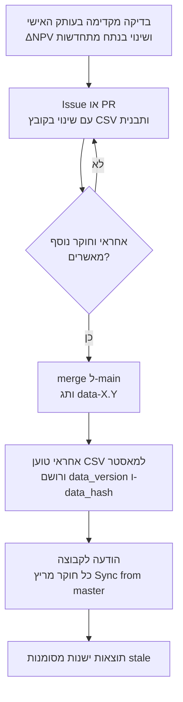
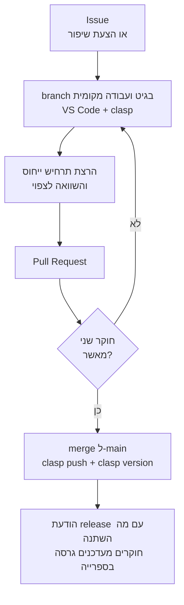

# NZO MODEL – עיצוב מודל עבודה משותף

מסמך עיצוב ותוכנית מימוש | אוקטובר 2026 | גרסה 2 – טיוטה לבדיקה

---

## 1. מטרה ועקרונות

**המטרה:** לאפשר לקבוצת חוקרים להריץ תרחישים על מודל NZO במקביל, בלי לדרוס זה את התוצאות של זה, בלי לשבור הנחות משותפות, ובלי שהקוד יתפצל לגרסאות לא ידועות.

**המצב היום:** גליון אחד (`NZO MODEL David1`) עם פרויקט Apps Script של 12 קבצים (כ-3,900 שורות). כל הרצה כותבת ללשוניות פלט קבועות (`10_`, `11_`, `12_`, `15_`, `31_`), ולכן שני חוקרים באותו קובץ דורסים זה את זה.

### עקרונות

1. **הפרדה בין נתונים, קוד ותוצאות.** כל אחד מהם נשמר, מנוהל ומתעדכן בנפרד. ההפרדה גם ויזואלית, בסכמת עיצוב אחידה (סעיף 4.9).
2. **מקור אמת אחד לכל דבר.** הקוד והנחות הבסיס בגיט. התוצאות בעותק האישי של כל חוקר.
3. **כל שינוי שמשפיע על כולם עובר גיט.** קוד ונתוני בסיס כאחד: Issue או PR, ביקורת, ורק אחר כך שינוי בפועל.
4. **עבודה אישית חופשית.** חוקר רשאי לעשות כל מה שהוא רוצה בעותק שלו, כולל תרחישי "מה אם" שלא נוגעים בבסיס.
5. **כל תוצאה יודעת מאיפה באה.** מי, מתי, איזו גרסת קוד, איזו גרסת נתונים.
6. **מתחילים קטן.** כל שלב נותן ערך בפני עצמו, וכך אפשר לעצור בכל נקודה.

---

## 2. הרכיבים

| רכיב | סוג | מי נוגע | תפקיד |
|---|---|---|---|
| **ריפו גיט** | GitHub/GitLab פרטי | כולם דרך PR | הקוד, נתוני הבסיס (CSV), תיעוד (`NZO_core.md`, `NZO_archive.md`), Issues |
| **ספריית קוד** | פרויקט Apps Script עצמאי | 1–2 אחראים לעריכה | הקוד של המודל, בגרסאות ממוספרות. המאסטר והעותקים קוראים לה (שלב מתקדם) |
| **גליון מאסטר** | Google Sheet | 1–2 אחראים, טעינה מהריפו בלבד | נגזרת של נתוני הבסיס בגיט, מקור ה-Sync לעותקים, תבנית לחוקרים חדשים. הסקריפט הצמוד אליו קורא לספרייה |
| **עותק אישי** | Google Sheet | חוקר אחד | הרצת תרחישים, קלט אישי, התוצאות והמטא-דאטה של החוקר |

הספרייה, המאסטר והעותקים האישיים יושבים ב-**Shared Drive** של הקבוצה, כדי שלא יהיו תלויים בחשבון של אדם אחד. מבנה התיקיות:

```
NZO (Shared Drive)
├── Master/          גליון המאסטר, מוגן
├── Researchers/     עותק לכל חוקר: שם_חוקר_פרויקט
└── Library/         פרויקט ספריית הקוד
```

כל חוקר עורך רק את העותקים שלו, ויכול לפתוח לצפייה את העותקים של האחרים. כך אפשר להשוות תוצאות בלי קובץ משותף.

---

## 3. ארכיטקטורה



### מה זורם לאן

- **קוד:** גיט ← ספרייה ← מאסטר ועותקים. בכיוון אחד בלבד. אף אחד לא עורך קוד בתוך עותק אישי.
- **נתוני בסיס:** גיט ← מאסטר ← עותקים (Sync). בכיוון אחד בלבד. אף אחד לא עורך את המאסטר ידנית.
- **תוצאות:** נשארות בעותק האישי. השוואה בין חוקרים נעשית בצפייה בעותקים ב-Shared Drive.
- **שינויים:** כל שינוי קוד או נתונים חוזר לגיט כ-Issue או PR ועובר אישור.

---

## 4. איך זה עובד בפועל

### 4.1 מבנה הלשוניות בעותק האישי

צבעי הלשוניות וכללי העיצוב מפורטים בסעיף 4.9.

| קבוצה | לשוניות | התנהגות |
|---|---|---|
| **מסונכרנות מהמאסטר** (protected, צבע לשונית אחיד) | `03_future-yearly-demand`, `12_raw-data-hourly`, `13_assumptions` | נדרסות בכל Sync. אסור לערוך ידנית |
| **התאמות מקומיות** | `07_local-overrides` (חדשה) | רישום של ערכי בסיס שהחוקר מחליף אצלו ושה-Sync לא ידרוס (סעיף 4.12). שייכת לחוקר, Sync לא נוגע בה |
| **קלט אישי** | `20_year-input`, `20_scenarios-input`, `30_scenarios-input`, `06_sensitivity-analysis`, `40_stochastic-analysis-input` | שייכות לחוקר. Sync לא נוגע בהן |
| **תוצאות שנשמרו** | `32_saved-scenarios`, `29_year-run-history` | שייכות לחוקר. Sync לא נוגע בהן. כאן נרשמות התוצאות והמטא-דאטה |
| **פלט חד-פעמי** | `10_`, `11_`, `12_`, `15_`, `21_`, `22_`, `31_`, `41_` | נכתבות מחדש בכל הרצה. מה שחשוב נשמר דרך `save Scenario` |
| **גרפים** | `50_charts`, `51_chart-data`, `59_my-charts` | `50_` ו-`51_` נכתבות מחדש בכל רענון גרפים (סעיף 4.10). `59_my-charts` שייכת לחוקר, והקוד לא נוגע בה |
| **סטטוס** | `_status` (חדשה) | גרסת קוד וגרסת נתונים של העותק, ואזהרות |

### 4.2 חוקר חדש מצטרף



### 4.3 הרצת תרחיש ושמירה



> **הערה (17.10.2026):** הלשונית `14_assumptions-yearly` והפעולה Calculate Costs הוסרו. אין עוד שלב חישוב אחרי Sync.

### 4.4 Sync מהמאסטר

פריט תפריט `Sync from master`:

1. פותח את המאסטר לפי ID מ-Config (`SpreadsheetApp.openById`).
2. קורא את `_meta` במאסטר: `data_version` (תג הגיט), `data_hash`, תאריך.
3. אם הגרסה זהה לגרסה בעותק, מציג "מעודכן" ויוצא.
4. מחשב hash על ערכי לשוניות המאסטר ומשווה ל-`data_hash`. אי התאמה פירושה שמישהו ערך את המאסטר ידנית: מציג אזהרה ועוצר.
5. בודק התאמה בין כותרות הלשוניות לבין מה שהקוד מצפה לו. אי התאמה מציגה אזהרה ועוצרת.
6. מעתיק **ערכים** (לא נוסחאות) ללשוניות המסונכרנות, **פרט לתאים ולשוניות שרשומים ב-`07_local-overrides`**. הם מדולגים והערך המקומי נשאר (סעיף 4.12).
7. בודק כל התאמה מקומית מול המאסטר: אם ערך המאסטר השתנה מאז שההתאמה נרשמה, מציג אותה כ"התנגשות" לטיפול החוקר.
8. (בוטל 17.10.2026: אין עוד לשונית `14_assumptions-yearly` ולא Calculate Costs.)
9. כותב ל-`_status`: גרסת נתונים חדשה, תאריך סנכרון, מספר ההתאמות המקומיות הפעילות וההתנגשויות, ומפעיל מחדש את סכמת העיצוב (סעיף 4.9).
10. מציג מה השתנה מאז הסנכרון האחרון (הפניה לרשימת השינויים של התג בגיט).

**לא נדרס:** כל לשוניות הקלט האישי, התוצאות והפלט, וכל מה שרשום ב-`07_local-overrides`.

### 4.5 שינוי בהנחות

קודם כול צריך להבחין בין שלושה סוגי שינוי, כי כל אחד נעשה במקום אחר:

| סוג | דוגמה | איפה עושים | מי מאשר |
|---|---|---|---|
| **"מה אם" (תרחיש)** | מה קורה אם עלות הסוללות נמוכה ב-30%? | בעותק האישי: `06_sensitivity-analysis` או הקלט האישי. לא נוגעים בבסיס | אף אחד, זה של החוקר |
| **התאמה מקומית קבועה** | חוקר עובד לאורך זמן עם עלויות משלו, או עם נתוני ביקוש אחרים, ולא רוצה שיידרסו | בעותק האישי, דרך `07_local-overrides` (סעיף 4.12). Sync מדלג על מה שרשום שם | אף אחד, זה של החוקר |
| **שינוי הנחת בסיס** | ספק פרסם מחיר חדש, נתון התיישן, נמצאה טעות | בגיט: PR שמשנה את קובץ ה-CSV | אחראי המאסטר וחוקר נוסף |

כלל: **במאסטר נכנסת ההערכה הטובה ביותר של הקבוצה.** כל הערכה חלופית נשארת תרחיש "מה אם" אצל מי שמאמין בה.

תהליך שינוי הנחת בסיס:



פירוט:

1. **בדיקה מקדימה (מומלץ).** החוקר משנה את הערך בהעתק של הלשונית בעותק האישי ומריץ, כדי לדעת מה ההשפעה. לשינוי שרוצים לשמור לאורך זמן משתמשים בהתאמה מקומית (סעיף 4.12), אחרת ה-Sync הבא ידרוס אותו. הריצות האלה נרשמות עם הסימון "נתונים מותאמים".
2. **PR או Issue.** מי שנוח לו עם גיט משנה שורה ב-`data/13_costs.csv` ופותח PR. מי שלא פותח Issue לפי התבנית (סעיף 4.8), והאחראי הופך אותו ל-PR. ה-PR מציג diff מדויק של הערכים.
3. **ביקורת ואישור.** אחראי המאסטר וחוקר נוסף מאשרים. תיקון טכני ברור (יחידות, טעות הקלדה) מאושר מהר. שינוי שמשנה תוצאות מהותית ממתין לדיון.
4. **merge ותג.** אחרי האישור ה-PR נכנס ל-`main`, ומוצמד תג `data-X.Y`. היסטוריית הגיט היא ה-changelog.
5. **טעינה למאסטר.** האחראי טוען את ה-CSV ללשונית (בהתחלה ידנית: File → Import → Replace sheet), ורושם ב-`_meta` את `data_version`. את `data_hash` מחשב פריט תפריט במאסטר (הוא קורא לספרייה).
6. **הודעה ו-Sync.** הקבוצה מקבלת הודעה, כל חוקר מריץ Sync, ותוצאות שנוצרו עם גרסת נתונים ישנה מסומנות `stale`.

**הגנה מפני סטייה.** המאסטר אמור להיות העתק של הריפו. אם מישהו עורך אותו ידנית, ה-hash ב-Sync לא יתאים והעותקים יקבלו אזהרה לפני שיעתיקו נתונים לא מאושרים.

### 4.6 שינוי קוד



**כלל חשוב:** שינוי שמשנה תוצאות מודל (כמו תיקון `windUsage` מרשימת "הנחות מידול לאישור") נחשב שינוי מודל. הוא עובר PR ומעלה גרסה ראשית (major), כדי שיהיה ברור שתוצאות ישנות לא ניתנות להשוואה ישירה.

### 4.7 קובץ דק בכל גליון (גם במאסטר)

הסקריפט הצמוד לגליון, במאסטר ובעותקים, מכיל רק:

- `onOpen`: בניית תפריט `NZO Model`.
- פונקציות עוטפות (wrappers) שקוראות לספרייה, למשל `function predictYear() { NZO.predictYear(SpreadsheetApp.getActive()); }`.
- אין בו לוגיקה של המודל.
- במאסטר: פריט תפריט שמחשב את `data_hash` ורושם אותו ב-`_meta`, ושקורא לפונקציה בספרייה.

הפונקציות בספרייה מקבלות את ה-`Spreadsheet` כפרמטר ולא מסתמכות על `getActive`. קבועי `SHEET_*` (18 קבועים שכבר קיימים) עוברים לספרייה, ולכן שם לשונית משתנה במקום אחד.

### 4.8 מבנה הריפו ותבניות

הריפו (ריק כרגע) נוצר בארגון NZO-ENERGY-THINK-TANK בשם `nzo_model`: `git@github.com:NZO-ENERGY-THINK-TANK/nzo_model.git`. מבנה התיקיות שלו:

```
nzo/
├── src/                     קוד Apps Script (clasp)
├── data/
│   ├── 13_costs.csv
│   ├── 03_future-yearly-demand.csv
│   ├── 12_raw-data-hourly.csv
│   └── README.md            סכמה: עמודות, יחידות, מקורות
├── reference/               תרחיש ייחוס ותוצאות צפויות
├── charts/                  קטלוג תבניות גרפים
├── docs/                    NZO_core.md, NZO_archive.md
└── .github/
    ├── ISSUE_TEMPLATE/assumption-change.md
    └── PULL_REQUEST_TEMPLATE.md
```

תבנית Issue לשינוי הנחה (`assumption-change.md`):

```
## הנחה לשינוי
קובץ ושורה/פרמטר:
שנים מושפעות:

## ערך
נוכחי:
מוצע:

## הצדקה
מקור (קישור או הפניה):
מדוע הערך הנוכחי שגוי או התיישן:

## השפעה שנמדדה (אם נבדקה)
שינוי ב-NPV (מיליארד):
שינוי בנתח מתחדשות:
שינוי בשיא הספק גז:

## דחיפות
```

ב-PR של נתונים נוסף: רשימת בדיקה (הערכים בתוך טווח סביר, היחידות זהות לשאר הקובץ, הוספתי מקור) והפניה ל-Issue.

### 4.9 סכמת עיצוב: הפרדה בין קלט לפלט

המטרה: מי שפותח עותק מבין תוך שניות מה מותר לו לערוך, מה נכתב מחדש בכל הרצה ומה שייך לקבוצה. אותה סכמה חלה על המאסטר ועל כל העותקים, והקוד אוכף אותה, כך שהיא לא נסחפת עם הזמן.

| תפקיד | לשוניות | צבע לשונית | תאים | התנהגות |
|---|---|---|---|---|
| **קלט אישי** | `01_`, `06_`, `20_`, `30_`, `40_` | כחול | תאי קלט עם רקע בהיר, הערת יחידות ו-data validation | עריכה חופשית. Sync לא נוגע |
| **נתוני בסיס** | `03_`, `04_`, `05_` | סגול | ללא רקע קלט, מוגנים. תא עם התאמה מקומית: רקע צהוב והערה (סעיף 4.12) | נדרסות ב-Sync, פרט להתאמות מקומיות. אזהרה בעריכה ישירה |
| **התאמות מקומיות** | `07_local-overrides` | סגול בהיר | רשימה בלבד | עריכה דרך תפריט "התאמות" |
| **פלט חד-פעמי** | `10_`, `11_`, `12_`, `15_`, `21_`, `22_`, `31_`, `41_` | ירוק | מוגנים | נכתבות מחדש בכל הרצה |
| **תוצאות שנשמרו** | `32_`, `90_` | כתום | מוגנים | הוספת שורות רק דרך `save Scenario` |
| **גרפים סטנדרטיים** | `50_charts`, `51_chart-data` | טורקיז | מוגנים | נכתבות מחדש בכל רענון גרפים (סעיף 4.10) |
| **גרפים אישיים** | `59_my-charts` | כחול | עריכה חופשית | הקוד לא נוגע בה |
| **סטטוס ועזרה** | `_README`, `_status`, `_meta` | אפור | מוגנים | מידע ואזהרות |

הכללים:

1. **תאים מחושבים בתוך לשוניות קלט** (כרגע אין כאלה; בעבר: ערכים ב-`20_year-input` שהגיעו מ-`14_assumptions-yearly` בנוסחה) מקבלים מראה "מחושב": טקסט אפור, בלי רקע קלט, והגנה. כך אין בלבול בין ערך שמזינים לערך שמתעדכן רק אחרי Calculate Costs.
2. **data validation בתאי קלט:** טווחים (למשל אחוזים 0–100), רשימות (שמות Scenario) וסוג נתון, עם הודעה שמסבירה מה מותר.
3. **הערה על כל תא קלט:** יחידה, מקור וברירת מחדל.
4. **הגנות במצב אזהרה בלבד**, בכל הגליונות, עם הסבר קצר ("הלשונית נדרסת בכל Sync"). בעותק האישי החוקר הוא הבעלים ולכן אי אפשר לחסום אותו ממילא. במאסטר האכיפה האמיתית היא הרשאות ה-Drive (חוקרים צופים בלבד) וגיט (שינוי רק דרך PR), ולא הגנת הלשונית.
5. **תפריט לפי תפקיד:** 1 קלט, 2 הרצה, 3 תוצאות, 4 סנכרון, 5 התאמות מקומיות, ופעולות מתקדמות בתת-תפריט. אותם שמות וסדר בכל עותק.
6. **אישור לפני דריסה:** פעולה שכותבת ללשוניות פלט, וכן Sync, מציגה חלון אישור עם רשימת הלשוניות שיידרסו.
7. **`_README`:** מקרא הצבעים, ארבעת השלבים של הרצה, רשימת בדיקה להרצה ראשונה וקישור למסמך זה.
8. **פורמט אחיד:** יחידות בכותרות (מיליארד ₪, MW), מספר ספרות קבוע ל-NPV ולאחוזים, אותם גופן וצבעי כותרת.
9. **`_status` עם סימון צבע** (ירוק, כתום, אדום) לגרסת הקוד ולגרסת הנתונים.

**יישום.** הסכמה מוגדרת בטבלה אחת בקוד, `DESIGN_SCHEME` בקובץ `src/design-scheme.gs`: לכל לשונית תפקיד, צבע, מצב הגנה וטקסט באנר. הפונקציה `applyDesignScheme()` מפעילה אותה, ללא תלות במצב הקודם (אפשר להריץ שוב ושוב). היא רצה בעת טעינת המאסטר ובסוף כל Sync בעותקים.

**שני אילוצים:**

- **לא מוסיפים שורות או עמודות לטבלאות קיימות.** הקוד והנוסחאות מפנים לתאים קבועים (למשל `312!B77`, ושורה 3 ב-`21_year-summary`). הסכמה מוחלת במקום: צבעים, validation, הערות והגנות על התאים הקיימים. באנר נכנס רק היכן שיש שורה פנויה, כמו שורה 2 ב-`21_year-summary`.
- **לא משנים שמות לשוניות.** הקידומות המספריות מתועדות ומוטמעות בקוד ובפיבוטים. הצבע והמקרא נותנים את אותה הפרדה בלי סיכון.

### 4.10 גרפים

גרף ב-Sheets הוא אובייקט בתוך גליון מסוים, צמוד לטווחי תאים. "Make a copy" מעתיק אותו רק ברגע ההעתקה, ואין חיבור חי בין תבנית לעותקים. בנוסף, גרף שקורא מטבלת ציר (pivot) נשבר כשפריסת הטבלה משתנה. לכן התבניות לא מחולקות כגרפים מועתקים, אלא כקוד שמעל חוזה נתונים יציב.

1. **חוזה נתונים יציב.** הלשונית `51_chart-data` נבנית בקוד מ-`31_scenarios-yearly` ומ-`32_saved-scenarios`, בכותרות קבועות. הכותרת `Cummulative` נשארת כמו שהיא, כי פיבוטים וגרף קיימים תלויים בה. תבניות הגרפים קוראות רק מהלשונית הזו, ולכן עובדות בכל עותק בלי תלות בפריסת הפיבוטים.
2. **תבניות כקוד.** כל תבנית מוגדרת בטבלה `CHART_TEMPLATES` בקובץ `src/chart-templates.gs`: שם, סוג גרף, עמודות המקור, כותרות צירים ויחידות, וצבעים מסכמת העיצוב (סעיף 4.9). צבע קבוע לכל Scenario, כך שאותו Scenario נראה אותו דבר בכל הגרפים ובכל העותקים.
3. **פריט תפריט.** "גרפים → צור או רענן גרפים סטנדרטיים" בונה את הגרפים בלשונית `50_charts`. הלשונית נכתבת מחדש בכל הפעלה, והגרפים האישיים של החוקר יושבים ב-`59_my-charts`, שהקוד לא נוגע בה.
4. **קטלוג בריפו.** בתיקייה `charts/` יושבת הגדרה לכל תבנית, עם תמונת דוגמה ותיאור קצר: מה היא מציגה ואילו נתונים היא דורשת. הוספת תבנית או שינוי בה הוא PR עם ביקורת, כמו כל שינוי משותף.
5. **הפצה.** תבנית חדשה או מעודכנת מגיעה לחוקרים דרך גרסת הקוד (גרסת הספרייה). חוקר שמעדכן גרסה ומריץ "רענן גרפים" מקבל אותה, ומי שלא מעדכן ממשיך עם הגרסה שלו.

המנגנון לא תלוי בסט הגרפים. את הסט עצמו אפשר להגדיר בהמשך, תבנית אחר תבנית.

**מגבלה:** ה-API של Apps Script לבניית גרפים לא מכסה את כל מה שהממשק מאפשר (למשל הערות מותאמות). גרף מורכב במיוחד אפשר להחזיק כגרף ידני בלשונית תבנית במאסטר ולהעתיק ידנית.

### 4.11 ניקיון ראשוני של דאטה וקוד ישנים

לפני שמעבירים את המודל לגיט ולמבנה המשותף מנקים אותו פעם אחת, כדי שהריפו, קבצי ה-CSV והעותקים הראשונים יתחילו נקיים. בלי זה הקוד המת, התוצאות הישנות ולשוניות הניסיון היו נכנסים להיסטוריית הגיט ומועתקים לכל חוקר. העיקרון: **מגבים לפני כל מחיקה, מוחקים בצעד נפרד ובאישור, ושום ניקיון לא משנה שורות או עמודות שהקוד והנוסחאות מפנים אליהן.**

**קוד.**

1. סריקה של 12 הקבצים: פונקציות, קבועים ומשתנים גלובליים שאין להם קורא (לא מתפריט, לא מ-`onOpen`, לא מפונקציה אחרת). התוצאה היא רשימת מועמדים, לא מחיקה אוטומטית.
2. כל מועמד נבדק ואושר, ונמחק בנפרד. הקוד שנמחק נשמר ב-`NZO_removed_code.md`.
3. אחרי כל מחיקה: בדיקת תחביר על כל הפרויקט ואימות אחרי טעינה מחדש.
4. משתנים וקבועים שמיקומם קובע שורה או עמודה בגליון (למשל `312!B77` ו-`21_year-summary` שורה 3) נשארים גם אם נראים לא בשימוש.
5. הקוד שהוסתר מהתפריט (ניתוח סטוכסטי ו-sensitivity) מסומן `deprecated` ולא נמחק עד שתתקבל החלטה (שאלה 7).

**דאטה.**

1. גיבוי מלא: עותק של הגליון כולו לפני שנוגעים בו.
2. מיון הקיים ב-`32_saved-scenarios` וב-`29_year-run-history`: מה נשמר כגרסת נתונים `data-0` (שאלה 4), ומה תוצאות ניסיון שאפשר להסיר.
3. הסרת לשוניות ושורות ניסיון, ונתוני ביניים שאין להם שימוש. לשוניות לא משנים את שמן ולא מוסיפים או מסירים בהן שורות או עמודות שיש עליהן הפניות.
4. אימות: מריצים כמה תרחישים לפני ואחרי ובודקים שהתוצאות זהות. אחרי שלב 5 האימות הוא תרחיש הייחוס.

### 4.12 התאמות מקומיות לנתוני בסיס

חוקר רוצה לעבוד לאורך זמן עם הנחות שונות מהמאסטר: עלות סוללות אחרת, תחזית ביקוש משלו, או סדרת נתונים שעבד עליה. לשוניות הבסיס (`03_`, `04_`, `05_`) נדרסות בכל Sync, ולכן עריכה ישירה שלהן תיעלם. הפתרון הוא שכבת התאמות: המאסטר נשאר המקור, וההבדלים המקומיים רשומים בנפרד ומוחלים מחדש אחרי כל Sync.

**הלשונית `07_local-overrides`.** שורה לכל התאמה:

| עמודה | תוכן |
|---|---|
| `tab` | הלשונית, למשל `13_assumptions` |
| `cell` | הכתובת של התא, או `*` ללשונית שלמה |
| `header` | הכותרת של העמודה ושל השורה (לבדיקה שהתא עדיין מצביע על אותו נתון) |
| `base_value` | ערך המאסטר ברגע שההתאמה נרשמה |
| `local_value` | הערך שהחוקר רוצה להשתמש בו |
| `note` | למה (חובה, כדי שאפשר להבין אחרי חודשים) |
| `created`, `status` | תאריך, ו-`active` או `conflict` |

**איך יוצרים התאמה.**

1. החוקר מסמן תא או טווח בלשונית בסיס ובוחר "התאמות → הגדר התאמה מקומית".
2. מזינים ערך חדש והערה. הקוד רושם שורה, כותב את הערך לתא ומסמן אותו (רקע צהוב והערה על התא, ראו סעיף 4.9).
3. אפשר גם לסמן לשונית שלמה כ"מקומית" (`cell = *`), למשל כשהחוקר עובד עם סדרת `12_raw-data-hourly` משלו. Sync מדלג עליה כולה.
4. "התאמות → בטל התאמה" מחזיר את ערך המאסטר ומוחק את השורה.

**מה עושה Sync.**

- לתאים רשומים: לא כותב. הערך המקומי נשאר, והחישוב רץ איתו.
- אם ערך המאסטר השתנה מאז `base_value` (למשל יצא `data-X.Y` שמעדכן את אותה עלות), ההתאמה מסומנת `conflict` ומוצגת רשימה: תא, ערך מאסטר חדש, ערך מקומי. לכל אחד שלוש אפשרויות: **להשאיר את שלי** (`base_value` מתעדכן לערך המאסטר החדש, וההתאמה ממשיכה), **לקבל את המאסטר** (ההתאמה נמחקת), או **להחליט אחר כך** (נשארת `conflict`, והערך המקומי נשאר).
- בלי החלטה לא קורה כלום לערך המקומי. הוא לא נדרס בשום מצב, וזו מטרת המנגנון.
- אם הכותרות בתא לא תואמות למה שנרשם, המבנה השתנה: ההתאמה מוצגת לבדיקה ולא מוחלת.

**תוצאות ושחזוריות.** כל הרצה בעותק עם התאמות פעילות נרשמת עם `data_modified = TRUE` ועם עמודה `overrides` שמכילה סיכום ההתאמות (מספרן ו-hash של רשימתן). כך אפשר להשוות בין חוקרים ולהבין למה המספרים שונים. תוצאה עם התאמות נחשבת `stale` רק כשגרסת הנתונים של המאסטר מתקדמת, כמו כל תוצאה אחרת.

**מהתאמה לשינוי משותף.** אם התברר שההתאמה נכונה לכולם, פותחים Issue או PR לפי סעיף 4.5. שורות מ-`07_local-overrides` נכנסות ישר לתבנית ה-Issue כהצדקה ו"ערך מוצע". אחרי שהשינוי נכנס למאסטר וה-Sync רץ, ההתאמה נסגרת בלי התנגשות כשערך המאסטר שווה לערך המקומי.

**אזהרות בלבד.** כמו בשאר הסכמה, הלשונית והסימונים מזהירים ולא חוסמים. חוקר שערך ישירות תא בסיס בלי לרשום התאמה יקבל אזהרה לפני Sync: "ערך שונה מהמאסטר, לרשום כהתאמה?".

---

## 5. מטא-דאטה לכל תוצאה

מרחיבים את `29_year-run-history` ואת `32_saved-scenarios` בעותק האישי בעמודות:

| עמודה | דוגמה | מקור |
|---|---|---|
| `run_id` | `2026-10-12T14:03_david_a3f9` | נוצר אוטומטית |
| `researcher` | `david@…` | `Session.getActiveUser()` |
| `timestamp` | `2026-10-12 14:03` | אוטומטי |
| `code_version` | `1.4.0` | קבוע בספרייה |
| `data_version` | `data-2.1` | מ-`_status` (תג הגיט) |
| `data_modified` | `TRUE` אם יש התאמות מקומיות פעילות | מחושב |
| `overrides` | מספר ההתאמות ו-hash של רשימתן (סעיף 4.12) | מחושב |
| `scenario_name` | `nuclear_2040_high` | קלט חוקר |
| `description` | "מה ניסינו ולמה" | קלט חוקר |
| `keyframes_snapshot` | JSON קצר או טווח לשונית | אוטומטי |
| `renewable_share`, `gas_energy`, `gas_capacity`, `npv`, ועוד | מספרים | פלט המודל |
| `stale` | `TRUE` אם גרסת הנתונים ישנה מהמאסטר | מחושב |

כך אפשר לענות על "למה המספרים שלך שונים משלי?" תוך דקה: פותחים את העותק של החבר (הוא ב-Shared Drive) ומשווים `code_version`, `data_version` ו-`keyframes_snapshot`.

**ביטחון בתוצאות.** העותקים יושבים ב-Shared Drive ולכן לא נעלמים כשחוקר עוזב.

---

## 6. הרשאות

| רכיב | אחראים (1–2) | חוקרים |
|---|---|---|
| ריפו גיט | admin | write דרך PR בלבד (branch protection על `main`, כולל קוד ונתונים) |
| ספריית קוד | עריכה | צפייה |
| גליון מאסטר | עריכה, בפועל טעינה מהריפו בלבד | צפייה |
| תיקיית החוקרים ב-Shared Drive | עריכה | כל חוקר עורך את העותק שלו וצופה בשל אחרים |
| עותק אישי | – | בעלים |

---

## 7. גרסאות

- **קוד:** `major.minor.patch`. major = שינוי שמשנה תוצאות מודל או מבנה לשוניות. minor = יכולת חדשה. patch = תיקון שלא משנה תוצאות.
- **נתונים:** תג גיט `data-X.Y` על קבצי `data/`. ה-changelog הוא היסטוריית הגיט והערות התג. התג נרשם גם ב-`_meta` של המאסטר.
- **שינוי שם לשונית בסיס משנה את ה-hash.** ה-hash כולל את שם הלשונית ואת הטווח (`#שם!טווח`), גם כשהנתונים זהים. לכן אחרי כל שינוי שם של לשונית בסיס (10–13) חובה להריץ במאסטר Update data hash ולתייג גרסת נתונים חדשה (למשל `data-1.8`, "אותם נתונים, hash חושב מחדש"). אחרת Sync בעותקים ייעצר עם "המאסטר אינו תואם ל-hash הרשום".
- **חוקרים מקבעים גרסת קוד** בהגדרות הספרייה ומעדכנים מתי שנוח להם. Development mode מיועד רק לאחראים.

---

## 8. סיכונים ופתרונות

| סיכון | פתרון |
|---|---|
| חוקר ערך קוד בעורך ו-`clasp push` ידרוס אותו | מסכימים: עורכים קוד רק בגיט. בספרייה הרשאת עריכה רק לאחראים |
| מישהו ערך את המאסטר ידנית והוא סטה מהריפו | `data_hash` ב-`_meta`, ו-Sync מזהה אי התאמה ועוצר עם אזהרה |
| חוקרים לא מתמצאים בגיט ולא יציעו שינויים בנתונים | נתיב Issue עם תבנית, והאחראי הופך אותו ל-PR |
| `13_assumptions` מכילה נוסחאות שאבדו בייצוא ל-CSV | לפני הייצוא הראשון לבדוק אילו תאים הם נוסחאות. מייצאים ערכים. נוסחאות שחשוב לשמר מתועדות ב-`data/README.md` |
| מגבלת 6 דקות של Apps Script | ההרצות הארוכות כבר מחולקות למנות (Enumerate Scenarios). נשארות כך. הספרייה לא משנה זאת |
| הפניה לספרייה נשברת לחוקר בלי הרשאה | שלב הצטרפות: מבקשים הרשאת צפייה לפני העתקה |
| מבנה לשונית משתנה והקוד נשבר | בדיקת כותרות בתחילת Sync והרצה, ו-major חדש עם הערת מיגרציה |
| עותק ישן מייצר תוצאות לא תואמות | שורת סטטוס, עמודת `stale`, אזהרה לפני הרצה |
| גרף שקורא מפיבוט נשבר כשהפריסה משתנה | חוזה נתונים יציב ב-`51_chart-data`. התבניות לא קוראות מפיבוטים |
| הוספת שורות או עמודות לטבלאות קיימות בגלל העיצוב שוברת נוסחאות וקוד | הסכמה מוחלת במקום (צבעים, validation, הערות). באנר רק בשורות פנויות. תרחיש הייחוס נבדק אחרי כל הפעלה |
| הגנה על לשונית לא מונעת מהבעלים של העותק לערוך אותה | ההגנות במצב אזהרה בלבד, עם הסבר. האכיפה האמיתית היא הרשאות ה-Drive על המאסטר ו-PR בגיט |
| תוצאות שנשמרו רק בעותק אישי נעלמות | העותקים ב-Shared Drive ולכן לא תלויים בחשבון של חוקר אחד |
| תוצאות מודל משתנות בלי שמישהו שם לב | תרחיש ייחוס אוטומטי לפני כל merge של קוד |
| ניקיון ראשוני מוחק בטעות קוד או תוצאה חשובה, או משנה מבנה | גיבוי מלא לפני, `NZO_removed_code.md`, מחיקה אחד-אחד באישור, בדיקת תחביר ואימות תוצאות לפני ואחרי. משתנים שקובעים שורות לא נמחקים |
| התאמה מקומית נשכחת ומייצרת תוצאות שונות משל האחרים בלי שמישהו שם לב | סימון צהוב בתא, `data_modified` ו-`overrides` בכל הרצה, ושורה ב-`_status` עם מספר ההתאמות הפעילות |
| התאמה מקומית מתנגשת עם עדכון נתונים חדש | בדיקת `base_value` בכל Sync, רשימת התנגשויות עם שלוש אפשרויות. הערך המקומי לא נדרס בלי החלטה |
| שינוי שם `Cummulative` שמשבר פיבוטים וגרף | נשאר כמו שהוא בכוונה (כפי שמתועד). לא נוגעים |

---

## 9. תוכנית מימוש

מסומן לכל שלב: מה עושים, תוצר וקריטריון הצלחה. אפשר לעצור אחרי כל שלב והמערכת תעבוד. התוכנית מנוסחת כרצף משימות למימוש, בלי הערכות זמן.

### שלב 1 – ניקיון ראשוני של דאטה וקוד

המטרה: להתחיל את המעבר לגיט ולמודל המשותף מבסיס נקי (סעיף 4.11).

1. גיבוי מלא של הגליון ושל פרויקט Apps Script.
2. סריקת קוד מת בשנים-עשר הקבצים, ואישור ומחיקה אחד-אחד. הקוד שנמחק נשמר ב-`NZO_removed_code.md`.
3. מיון התוצאות ב-`32_saved-scenarios` וב-`29_year-run-history`, והסרת לשוניות ושורות ניסיון.
4. אחרי כל שינוי: בדיקת תחביר, אימות אחרי טעינה מחדש, והשוואת תוצאות של כמה תרחישים לפני ואחרי.
5. עדכון `NZO_archive.md` ו-`NZO_core.md`.

**קריטריון הצלחה:** התוצאות של תרחישי הבדיקה זהות לפני ואחרי, ואין בגליון קוד או נתונים שאין להם שימוש.

### שלב 2 – החלטות מקדימות

- [x] כמה חוקרים ורמת הנוחות: כ-5 חוקרים, היכרות בסיסית עם גיט.
- [ ] מי 1–2 האחראים על המאסטר והספרייה?
- [x] הריפו: GitHub, ארגון NZO-ENERGY-THINK-TANK, `nzo_model` (נוצר, ריק).
- [ ] האם יש Shared Drive לעותקים?
- [ ] האם כל החוקרים באותו ארגון Google (משפיע על הרשאות וקישורים)?
- [x] מאשרים לשינוי הנחת בסיס: שניים (אחראי המאסטר וחוקר נוסף).
- [x] נוסחאות ב-`13_assumptions`: מוותרים, מייצאים ערכים בלבד.
- [x] תוצאות קיימות ב-`32_saved-scenarios`: אפשר למחוק (בגיבוי ובאישור).

**תוצר:** רשימת אחראים ומקום לכל רכיב.

### שלב 3 – גיט ו-clasp

הריפו הריק כבר קיים: `git@github.com:NZO-ENERGY-THINK-TANK/nzo_model.git`.

1. התקנת Node.js ו-`npm install -g @google/clasp`, ואז `clasp login`.
2. הפעלת Apps Script API בהגדרות החשבון.
3. `clasp clone <scriptId>` של 12 הקבצים.
4. `git init`, `.gitignore`, `.claspignore`, קומיט ראשון.
5. העלאה לריפו פרטי, והעברת `NZO_core.md` ו-`NZO_archive.md` אליו (בתיקיית `docs/`).
6. הוספת הפתוחים כ-Issues: `312!B77:B79`, `310!A111` (#REF!), איחוד פורמט `21_year-summary`, שתי שורות לא בשימוש ב-`40_`, ושאלות המידול שבסעיף "הנחות מידול שכדאי לאשר".

**קריטריון הצלחה:** `clasp push` מעלה את הקוד והגליון עדיין עובד בדיוק כמו קודם. **ערך מיידי:** היסטוריית שינויים.

### שלב 4 – נתוני בסיס בגיט

1. בודקים ב-`13_assumptions`, `03_future-yearly-demand`, `12_raw-data-hourly` אילו תאים הם נוסחאות ואילו ערכים.
2. מייצאים כל לשונית ל-CSV (ערכים) לתיקיית `data/` בריפו.
3. כותבים `data/README.md`: עמודות, יחידות, מקורות, נוסחאות שדורשות תיעוד.
4. מוסיפים `.github/ISSUE_TEMPLATE/assumption-change.md` ו-`PULL_REQUEST_TEMPLATE.md` (סעיף 4.8).
5. מגדירים branch protection על `main`: PR חובה. לשינוי ב-`data/` נדרשים שני אישורים (אחראי המאסטר וחוקר נוסף), ולשינוי ב-`src/` אישור אחד לפחות (אפשר להגדיר זאת עם CODEOWNERS על התיקיות).
6. מצמידים תג `data-1.0` על המצב הנוכחי.

**קריטריון הצלחה:** שינוי ערך אחד ב-CSV מופיע כ-diff ברור ב-PR, ואפשר לשחזר את הלשונית מהקובץ.

### שלב 5 – תרחיש ייחוס

1. מגדירים שנה אחת ותרחיש keyframes קבוע, ומריצים.
2. שומרים את התוצאות הצפויות (NPV, נתח מתחדשות, ייצור גז, שיא הספק גז) בקובץ ב-`reference/`.
3. כותבים פונקציה `runReference()` שמריצה ומשווה, ומדפיסה "עבר" או "נכשל" עם הפרש.
4. נוהל: כל PR של קוד חייב להריץ אותה, ולצרף את התוצאה לתיאור ה-PR. PR של נתונים מצרף את ה-ΔNPV.

**קריטריון הצלחה:** שינוי מכוון קטן בקוד גורם לכישלון שמזוהה.

### שלב 6 – מטא-דאטה בהרצות

1. הוספת `code_version` כקבוע בקוד, ו-`data_version` ו-`data_hash` ב-`_meta` של הגליון.
2. הרחבת `29_year-run-history` ו-`save Scenario` בעמודות מסעיף 5.
3. הוספת שדה "תיאור" בקלט `save Scenario`.
4. שורת סטטוס בלשונית `_status`.

**קריטריון הצלחה:** כל שורה חדשה בהיסטוריה כוללת מי, גרסה ותיאור.

### שלב 7 – מבנה מאסטר ועותקים

1. יצירת גליון מאסטר מהגליון הנוכחי: ניקוי קלט אישי ופלטים, השארת הנחות בסיס ותרחיש לדוגמה.
2. טעינת ה-CSV של `data-1.0` ללשוניות המאסטר, והוספת `_meta` (`data_version`, `data_hash`).
3. סימון לשוניות מסונכרנות (צבע, protected range) ולשוניות קלט.
4. הקמת תיקיות ה-Shared Drive (`Master`, `Researchers`, `Library`) והרשאות.
5. הוספת ה-ID של המאסטר לקובץ Config בקוד.
6. פריט תפריט במאסטר לחישוב `data_hash` ורישומו ב-`_meta` (בשלב 12 הוא עובר לספרייה).

**קריטריון הצלחה:** חוקר אחד יכול לעשות עותק בתיקיית החוקרים, להריץ ולשמור תוצאה ב-`32_saved-scenarios` שלו.

### שלב 8 – סכמת עיצוב

1. מגדירים מקרא צבעים ותפקיד לכל לשונית, וכותבים את הטבלה `DESIGN_SCHEME` ב-`src/design-scheme.gs`.
2. כותבים `applyDesignScheme()`: צבעי לשוניות, הגנות במצב אזהרה בלבד, הערות ו-data validation בתאי קלט, ועיצוב מובחן לתאים מחושבים.
3. מוסיפים את הלשונית `_README` וסימון צבע ב-`_status`.
4. מסדרים את התפריט לפי תפקיד, ומוסיפים אישור לפני דריסה.
5. מריצים במאסטר ובעותק ניסיון, ובודקים שאף נוסחה, פיבוט או גרף לא נשבר.

**קריטריון הצלחה:** חוקר שלא הכיר את הגליון מזהה תוך דקה מה מותר לערוך, ותרחיש הייחוס עובר בלי שינוי.

### שלב 9 – גרפים סטנדרטיים

1. מגדירים את חוזה הנתונים: הלשונית `51_chart-data` עם כותרות קבועות, ופונקציה שבונה אותה מ-`31_scenarios-yearly` ומ-`32_saved-scenarios`.
2. כותבים את `CHART_TEMPLATES` ואת `applyChartTemplates()` ב-`src/chart-templates.gs`, ופריט תפריט "גרפים".
3. מוסיפים לריפו את `charts/` עם README: מבנה הגדרת תבנית, ואיך מוסיפים או משנים תבנית ב-PR.
4. מגדירים תבנית אחת לדוגמה כדי לאמת את המנגנון מקצה לקצה, ומוסיפים לתרחיש הייחוס בדיקה שהלשונית נבנית והגרף נוצר בלי שגיאה. שאר הסט ייקבע בהמשך.

**קריטריון הצלחה:** חוקר מריץ "צור גרפים סטנדרטיים" בעותק חדש ומקבל את אותם גרפים כמו חוקר אחר, מהנתונים של העותק שלו.

### שלב 10 – פונקציית Sync

1. כתיבת `syncFromMaster()` לפי סעיף 4.4, כקובץ חדש `sync.gs`.
2. בדיקת כותרות ו-`data_hash` מול סכמה מוגדרת בקוד.
3. הרצת `applyDesignScheme()` אוטומטית אחרי Sync (Calculate Costs הוסר 17.10.2026).
4. הוספת פריט תפריט ושורת סטטוס.
5. **נדחה (בעיה ידועה):** מנגנון התאמות מקומיות לפי סעיף 4.12 (לשונית התאמות, פריטי תפריט, דילוג ב-Sync, זיהוי התנגשויות, עמודת `overrides` בהרצות). במקומו: חלון האישור של Sync מציג כמה תאים ישתנו ומזהיר על עריכות ידניות שיידרסו. קוד שנוסה (10ב-1) נשמר ב-`NZO_removed_code.md`.

**קריטריון הצלחה:** שינוי ב-`13_assumptions` בגיט, טעינה למאסטר ואחריה Sync בעותק מעדכנים את `13_assumptions` בעותק, ו-`_status` מתעדכן. עריכה ידנית של המאסטר גורמת לאזהרה. תא שנרשם כהתאמה מקומית נשאר עם הערך המקומי אחרי Sync, ושינוי באותו תא במאסטר מוצג כהתנגשות.

### שלב 11 – הצטרפות ראשונה

1. כתיבת עמוד "איך מתחילים" (README בריפו): העתקה, הרשאות, Sync ראשון, הרצת תרחיש ייחוס, איך מציעים שינוי הנחה (סעיף 4.5).
2. חוקר אחד אמיתי עובר את התהליך כולו, כולל PR של נתונים אחד. מתקנים כל מה שתקע אותו.
3. מגדירים נוהל שמות: `שם_חוקר_פרויקט` לעותקים, `שם_חוקר_תרחיש_תאריך` לתרחישים.

**קריטריון הצלחה:** חוקר חדש מגיע לתוצאה ראשונה תוך שעה בלי עזרה.

### שלב 12 – מעבר לספרייה (בהמשך)

כדאי לבצע כשהקוד התייצב. עם כ-5 חוקרים זה רלוונטי.

1. פרסום הקוד כספריית Apps Script עם גרסה ראשונה.
2. החלפת הסקריפט בכל גליון, כולל המאסטר, בקובץ דק עם wrappers, והעברת `Spreadsheet` כפרמטר במקום `getActive`.
3. בדיקה על גליון ניסיון, כולל הרשאות ומגבלת הזמן.
4. הנחיית החוקרים לקבע גרסה.
5. נוהל release: PR, תרחיש ייחוס, `clasp version`, הודעה.

**קריטריון הצלחה:** תיקון קוד אחד מגיע לכל החוקרים בלי שמישהו מעתיק קוד.

### סיכום השלבים

| שלב | ערך |
|---|---|
| 1 ניקיון ראשוני | בסיס נקי להעברה לגיט |
| 2 החלטות | בהירות |
| 3 גיט + clasp | היסטוריה, בדיקת קוד |
| 4 נתוני בסיס בגיט | ביקורת והיסטוריה לנתונים |
| 5 תרחיש ייחוס | ביטחון בשינויים |
| 6 מטא-דאטה | שחזוריות |
| 7 מאסטר ועותקים | עבודה מקבילית |
| 8 סכמת עיצוב | הפרדה ברורה בין קלט לפלט |
| 9 גרפים סטנדרטיים | גרפים עקביים בקלות |
| 10 Sync | עדכון נתונים קל ובטוח |
| 11 הצטרפות ראשונה | אימות התהליך |
| 12 ספרייה | עדכון קוד אחיד |

שלב 12 מתבצע בהמשך, כשהקוד התייצב. עם כ-5 חוקרים הוא רלוונטי.

---

## 10. שאלות פתוחות

1. ~~כמה חוקרים ומה רמת הנוחות שלהם עם גיט?~~ **הוחלט:** כ-5 חוקרים, היכרות בסיסית עם גיט. לכן ביקורת PR נשארת (עם תבנית Issue כנתיב קל), ומעבר לספרייה (שלב 12) רלוונטי.
2. ~~כמה מאשרים נדרשים לשינוי הנחת בסיס?~~ **הוחלט:** שני מאשרים (אחראי המאסטר וחוקר נוסף). שינוי קוד נדרש לאישור אחד לפחות.
3. ~~האם `13_assumptions` ושאר לשוניות הבסיס מכילות נוסחאות שחשוב לשמר?~~ **הוחלט:** יש נוסחאות, אבל אפשר לוותר עליהן. מייצאים ל-CSV ערכים בלבד.
4. ~~מה עושים עם התוצאות הקיימות ב-`32_saved-scenarios`?~~ **הוחלט:** אפשר למחוק. המחיקה תבוצע בשלב ההכנה של הגליון, אחרי גיבוי ובאישור לפני כל מחיקה.
5. האם תידרש השוואה שיטתית בין תוצאות של חוקרים שונים? אם כן, אפשר להוסיף בהמשך גליון תוצאות אופציונלי.
6. אילו טווחים ורשימות ערכים מותרים לכל פרמטר ב-`20_year-input` (data validation)? נקבע יחד עם החוקרים.
7. האם הניתוחים הסטוכסטי וה-sensitivity (מוסתרים בתפריט) אמורים לחזור, ואם כן באיזה אופן ישמרו?
8. האם נדרש ייצוא גרפים לתמונה (PNG) להדבקה במצגות ובמאמרים?
9. האם התאמה מקומית תהיה לרמת תא בלבד, או גם לרמת לשונית שלמה (כמו בסעיף 4.12)? והאם ברירת המחדל בהתנגשות היא להשאיר את הערך המקומי (ההצעה) או לעצור ולשאול?
